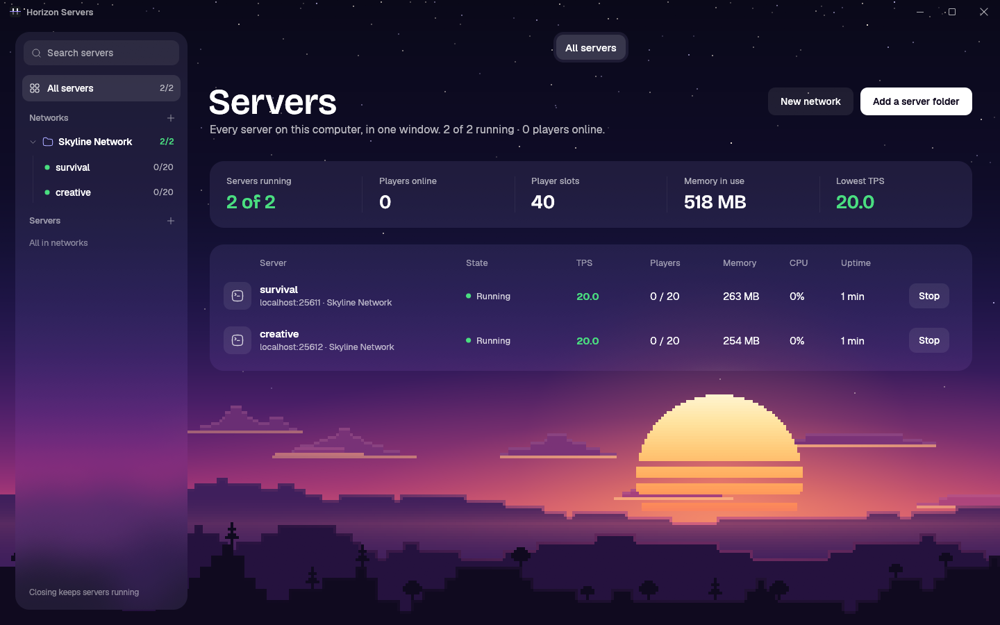
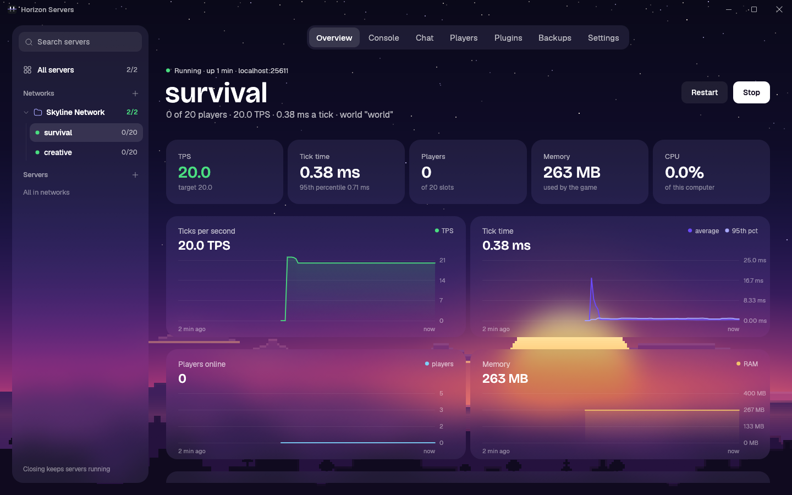
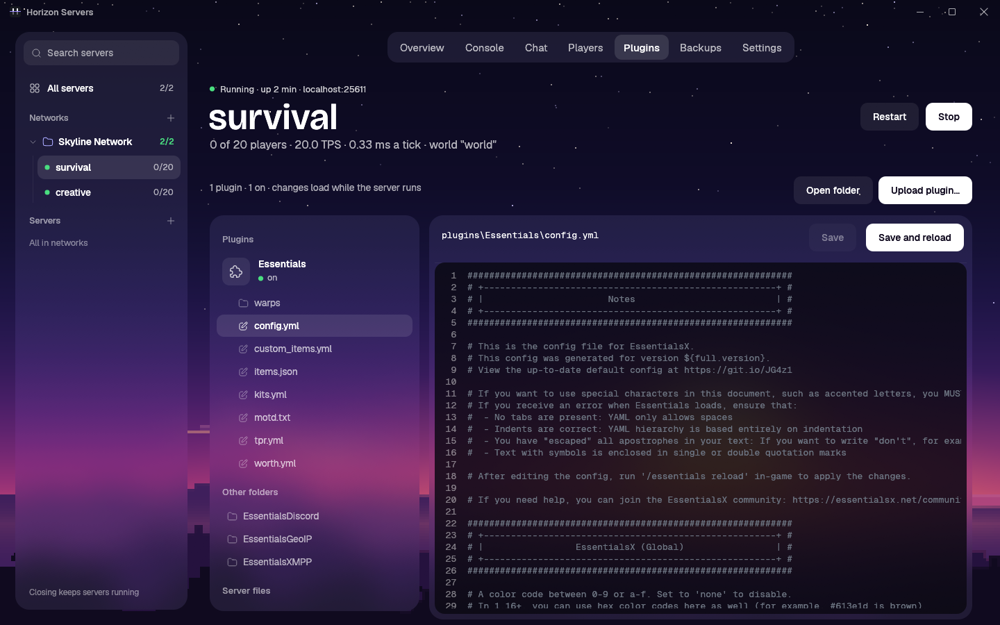
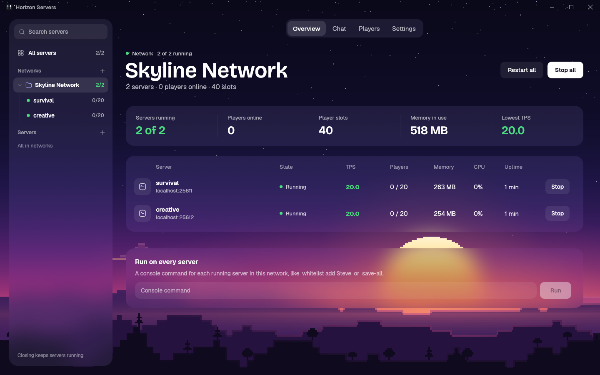

# The server panel

`rustpaper-panel` is one window for every server on your computer. Vanilla gives each server its own window;
with ten servers that is ten windows. The panel shows them all, side by side, and manages each one.

## Opening it

| Command | What it does |
|---|---|
| `python setup.py start myserver` | starts the server in the background and opens the panel on it |
| `python setup.py start myserver --nogui` | starts it headless; remembered, so the next `start` opens no window either (`--gui` changes it back) |
| `python setup.py panel` | opens the panel (the first time, it is built: about 2 minutes) |
| `python setup.py panel myserver` | opens it on one server |
| `python setup.py stop myserver` | stops a server |

Only one panel runs at a time: opening it again brings the open one forward. Closing the panel never stops a
server: they keep running in the background, and the panel finds them again when it opens.

The panel finds servers by itself:

- every server made with `python setup.py server`,
- every server already running on this computer (from `setup.py`, `horizon-server run` in a terminal, or a
  service), found by its process,
- any folder you add with **+ Server** (a folder with a `server.toml`).

The list is kept in `servers.json` in your settings folder (`%APPDATA%\rustpaper` on Windows,
`~/.config/rustpaper` on Linux). **Remove from list** in a server's settings only takes it off the list: nothing
is deleted.

## The sidebar

One line per server: its state's dot, its name, and its players (`3/20`, or `Off` when it is stopped).
**Search servers** at the top filters the list (networks with a match open by themselves). Right-click a
server to start or stop it or move it to a network; right-click a network to rename or delete it.

## All servers

The first page: totals for every server (running, players online, slots, memory, lowest TPS) and a table with one
row per server: its state, TPS, players, memory, CPU and uptime, and Start or Stop. Click a row to open it.

## A server

| Tab | What's there |
|---|---|
| **Overview** | TPS, tick time (average and 95th percentile), players, memory and CPU, and graphs of the last 10 minutes; recent joins, leaves, chat and deaths |
| **Console** | the live log (warnings and errors in colour, a filter box) and a command line (up and down go through what you typed) |
| **Chat** | what players say, who joins and leaves, deaths and kicks; type to message everyone as `[Server]` |
| **Players** | who's online with their ping, and Make op, Kick, Ban, Ban IP; a player by name (op, whitelist, ban); the operators, whitelist (on/off), banned players and banned addresses, each with undo |
| **Plugins** | every plugin, on or off: Upload, Reload now, Replace with a new build, Turn off/on, Delete; each plugin's config files, and the server's own files, in the built-in editor |
| **Backups** | Back up now (a running server saves first and stays up) and Restore (the current world is kept first) |
| **Settings** | message of the day, port, player slots, difficulty, game mode, view and simulation distance, online mode, whitelist, hardcore; the server's network; whether `start` opens the panel |

Start, Restart and Stop are at the top right of every server.

### Plugins and the editor

Plugins load while the server runs: an uploaded plugin is on within seconds, a newer build replaces the old one
the same way, and a deleted or turned-off plugin is unloaded. Turning a plugin off keeps its file, renamed
`.disabled`.

Click a plugin to see its config files (its `plugins/<Name>/` folder), and click a file to open it in the
editor: line numbers, colours for YAML, JSON, TOML and properties files, **Save** (Ctrl+S), and
**Save and reload**, which saves and reloads the plugin so it reads the change. `server.toml`, the operators and
the ban lists open there too. A file you haven't saved is never thrown away without asking.

## Networks

A network is a folder of servers that belong together, such as a lobby, survival and minigames behind one proxy.
Make one with **+ Network**, then right-click a server and choose **Move to network**, or tick its servers in the
network's Settings tab.

Click a network for its own page:

| Tab | What's there |
|---|---|
| **Overview** | the network's totals and its servers; Start all, Restart all, Stop all; a command run on every server at once |
| **Chat** | the chat of every server in one feed, each line tagged with its server; one message to every server |
| **Players** | everyone online across the network and where they are; Kick, Ban everywhere; a player by name on every server (whitelist, op, unban, ban) |
| **Settings** | rename the network, choose its servers, delete it (its servers stay) |

## How it works

Each server's supervisor (`horizon-server`) serves a control API on 127.0.0.1 with a random token in the server's
`.horizon/api.json`, which only your user can read. The panel reads that file and uses the API for everything a
running server does (status, graphs, log, chat, players, commands, stop and restart), and `horizon-server`'s own
commands for the rest (start, backups, settings). So the panel manages exactly the servers your user can, and
nothing listens on the network for it. Its pictures are taken by the panel itself:
`rustpaper-panel --select DIR --tab plugins --screenshot out.png`.
